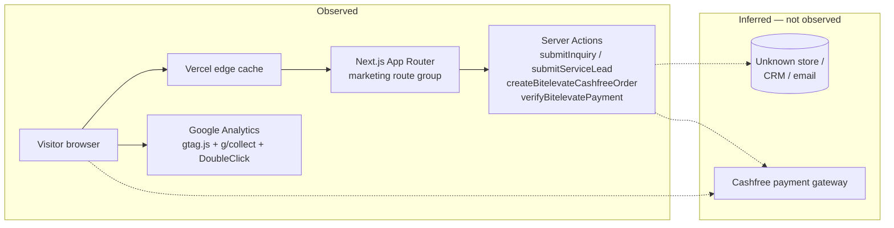

# 2. Architecture analysis

Every statement below is labelled **Observed** (directly in saved evidence)
or **Inferred** (the simplest explanation of observed evidence, still open
to correction by the site owners). Nothing in this section comes from
server code, which passive testing cannot see.

## 2.1 Observed stack

| Layer | Evidence |
|---|---|
| Hosting / edge | `Server: Vercel` in all 29 header files; `X-Vercel-Cache`, `X-Vercel-Id`, `X-Matched-Path` headers |
| Framework | `/_next/static/...` chunk URLs in every page; RSC `Vary: rsc, next-router-state-tree, next-router-prefetch, next-router-segment-prefetch`; `self.__next_f` payloads in HTML; `X-Powered-By: Next.js` on `/careers` only |
| Rendering | Most pages carry `X-Nextjs-Prerender: 1` and `X-Nextjs-Stale-Time: 300` — prerendered pages with a 300 s client-router stale time |
| Routing | Chunk path `app/(marketing)/...` in page bundles — a Next.js App Router `(marketing)` route group |
| Analytics | `googletagmanager.com/gtag/js` preload in every page; a `GoogleAnalytics` component in the layout chunk (see `evidence/html/home-r1.html`). Runtime-confirmed: the recorded browser load contacted `analytics.google.com`, `stats.g.doubleclick.net` and `www.google.co.in/ads/ga-audiences`, and wrote two `_ga*` cookies |
| Fonts | `fonts.googleapis.com` stylesheet (Material Symbols) plus two self-hosted `/_next/static/media/*.woff2` fonts |
| Payments (BitElevate only) | `https://sdk.cashfree.com/js/v3/cashfree.js` loaded dynamically by the BitElevate page bundle; Server Actions `createBitelevateCashfreeOrder` and `verifyBitelevatePayment` |
| Protocol (browser-observed) | Chrome negotiated `h2` for all 54 requests of the recorded homepage load; the origin sent no `Alt-Svc` header, so HTTP/3 was not offered (third-party Google endpoints did offer `h3`). TLS version not observed — see §1 |
| Structured data | JSON-LD `ProfessionalService` on every page, plus `ContactPage`, `FAQPage`, `SoftwareApplication`, `BreadcrumbList` on individual pages |

## 2.2 Observed API surface: Server Actions, not REST

No `/api/` URL, no `fetch(` to an external API, and no GraphQL endpoint
appears in any of the three page bundles analysed
(`evidence/bundle-analysis.txt`: `api-like paths: (none)` for all three).

Form submission is instead done through Next.js Server Actions, named in
the client bundles via `createServerReference`:

| Page | Form fields (HTML) | Server Action (bundle) |
|---|---|---|
| `/contact` | `fullName` (required), `email` (required, `type=email`), `company`, `industry`, `message` (required textarea) | `submitInquiry` |
| `/products` | `fullName` (required), `email` (required, `type=email`), `company` (required), `message` (required textarea), plus a product selector (`serviceType` appended in JS) | `submitServiceLead` |
| `/bitelevate` | `fullName`, `university`, `email` (`type=email`), `phone`, `track` (select), `duration` (select), `referralName`, `ambitions` (textarea) — all required except `referralName` | `createBitelevateCashfreeOrder`, then `verifyBitelevatePayment` |

Form tags have **no `action` or `method` attribute** in the HTML
(`evidence/html-inventory.txt`); the handler is `onSubmit` in React, which
passes a `FormData` object to the Server Action and shows a generic
success/error message. The Server Action request itself was **never sent**
in this audit (that would be a form submission), so the following are
**not** observable from outside and are not claimed here: the Server
Action's HTTP shape, its validation, its rate limiting, its storage
destination, or its error format.

The BitElevate bundle additionally references an intern portal login
(`cynbit.in/intern-portal/login`) shown only after a successful payment
verification, with credentials displayed to the user for copying. That
portal was not visited and its login was not tested.

## 2.3 Observed rendering / caching split

| Group | Headers | Interpretation |
|---|---|---|
| `/`, `/contact`, `/services`, `/products`, `/bitelevate` | `Cache-Control: public, max-age=0, must-revalidate`, `X-Vercel-Cache: HIT`, `Age: ~29,600 s` on all 3 repeats, weak `ETag`, `X-Nextjs-Prerender: 1` | Prerendered, edge-cached pages. This is Vercel's normal default: `max-age=0` tells the browser to revalidate on every visit, while the edge may still serve its own cached copy (hence `HIT` and an edge `Age` of ~8.2 h). `Age` is an edge-cache age, not a browser-cache age, so the two values are not contradictory. |
| `/careers` | `Cache-Control: private, no-cache, no-store, max-age=0, must-revalidate`, `X-Vercel-Cache: MISS` on all 3 repeats, no `ETag`, no `X-Nextjs-Prerender`, `X-Powered-By: Next.js`, plus `Link` preload headers | A dynamic (non-prerendered) route, rendered on every request. Why it differs from the other marketing pages is not visible from outside. |
| `/sitemap.xml` | `X-Vercel-Cache: MISS` on all 3 repeats, `Content-Type: application/xml`, slowest TTFB (see §2.5) | Dynamically generated on each request: the 16 top-level URLs carry `lastmod` equal to the request time (`2026-10-29T21:28:00.454Z`), while blog/case-study entries carry older, distinct timestamps. |
| `/robots.txt` | First repeat `MISS`, then `HIT` (`Age: 51`, then `2974` on the third repeat — different edge ages) | A small static file, cached normally after first fetch. |

## 2.4 Inferred architecture diagram

Inferred items are marked with dashed arrows. In particular, where form
submissions are stored (database, CRM, email inbox, or spreadsheet) is
**unknown** from passive evidence, and no datastore is claimed. Google
Analytics moved into the observed group only after the browser capture in
`evidence/har/` recorded the actual `g/collect` requests on load; what
happens to the data *after* it reaches Google — retention, consent
scope, and any audience sharing — remains inferred (VAL-02).

## 2.5 Observed timings and sizes

From `evidence/timings/*-r*.timing.txt` (curl `time_starttransfer` = TTFB
including DNS + connect + TLS ≈ 0.08 s in this environment; `size_download`
is the compressed wire size, not the decompressed file size):

| Page | TTFB r1 / r2 / r3 (s) | Total r1 / r2 / r3 (s) | Wire size (bytes) | HTML file size (decompressed) |
|---|---|---|---|---|
| `/` | 0.747 / 0.337 / 0.271 | 0.802 / 0.393 / 0.318 | 15,402 | ~100 KB |
| `/contact` | 1.160 / 0.488 / 0.475 | 1.210 / 0.534 / 0.495 | 11,189 | ~64 KB |
| `/careers` | 1.235 / 0.508 / 0.652 | 1.290 / 0.533 / 0.710 | 13,435–13,523 | ~125 KB |
| `/services` | 0.617 / 0.519 / 0.420 | 0.665 / 0.567 / 0.477 | 11,245 | ~76 KB |
| `/products` | 0.595 / 0.539 / 0.469 | 0.683 / 0.639 / 0.522 | 14,468 | ~82 KB |
| `/bitelevate` | 0.582 / 0.533 / 0.481 | 0.640 / 0.645 / 0.561 | 24,445 | ~220 KB |
| `/sitemap.xml` | 1.818 / 0.992 / 1.106 | 1.859 / 1.033 / 1.109 | ~1,505 (compressed XML) | ~14 KB |
| `/robots.txt` | 0.511 / 0.414 / 0.371 | 0.511 / 0.415 / 0.371 | 200 | 200 B |
| 404 probe | 0.634 | 0.675 | 4,368 | ~15 KB |

Readings: first runs are consistently slower (cold edge / cold render),
warm runs settle around 0.3–0.7 s TTFB from this environment. That is
acceptable for a marketing site but not fast, and the two always-`MISS`
routes (`/careers`, `/sitemap.xml`) never benefit from edge caching.
All HTML responses used Brotli (`Content-Encoding: br`).

Page JS chunks downloaded (decompressed / wire): contact 24 KB / 6.3 KB,
products 44 KB / 10.6 KB, BitElevate 90 KB / 21.6 KB. These are **page
chunks only**; shared chunks (framework, layout) were not downloaded, so
no total-JS figure is claimed.

## 2.6 Third parties observed in a normal page

**From HTML only** (`evidence/html-inventory.txt`, before any browser
interaction): Google Tag Manager / Analytics, Google Fonts, and social
links (LinkedIn, Instagram, Facebook, X). From the BitElevate bundle only:
Cashfree SDK and a GitHub link. No CRM, lead-gen widget, chat widget,
captcha provider, or other form backend is visible in the HTML or in the
three page bundles.

**From an actual browser load** (`evidence/har/homepage-network-summary.md`,
one passive homepage load, 54 requests): 48 requests to
`www.cynbit.in` and **6 to third parties** —
`fonts.gstatic.com` (1.11 MB icon font), `www.googletagmanager.com`
(199 KB `gtag/js`), `fonts.googleapis.com` (Material Symbols CSS),
`analytics.google.com` (`g/collect` POST), `stats.g.doubleclick.net`
(`g/collect` POST) and `www.google.co.in/ads/ga-audiences` (pixel GET).
The two POSTs and the pixel fired **with zero user interaction** during
page load. Third parties account for ~77% of transferred bytes on that
load.

Two corrections this evidence forces on the HTML-only view:

- **`analytics.google.com` and DoubleClick were not visible in the HTML**
  — they are contacted at runtime by the GTM container. Any statement
  that "only GTM/Fonts are loaded" was true of the markup and false of
  the page; the runtime view is now the one quoted in `docs/03` (VAL-02).
- **No `/api/`, Server Action, or `fetch` to a Cynbit backend endpoint
  occurred** during that load; the only POSTs were the two Google
  analytics hits. This supports §2.2 and ARCH-02 at runtime rather than
  by static analysis alone.

Absence in these files is not proof of absence on other pages or after
interaction; this remains one load of one page.
