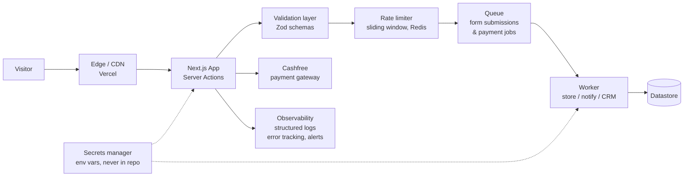

# 4. Recommended improvements

Prioritised by value for a small team: cheapest, highest-leverage changes
first. Each item links to the finding(s) it addresses. Snippets in
`snippets/` are minimal, commented, and tested where runnable.

## Quick wins — this week

| # | Action | Findings | Benefit | Trade-off / risk |
|---|---|---|---|---|
| Q1 | Add global security headers in Next.js `headers()` — CSP (report-only first), `nosniff`, `frame-ancestors`, Referrer-Policy, Permissions-Policy | SEC-01, SEC-02, ERR-01 | Browser-enforced script/frame restrictions on every route, including 404 | A too-strict CSP breaks Analytics/Fonts/Cashfree; start report-only, allow-list only observed hosts, then enforce |
| Q2 | Set `poweredByHeader: false` in `next.config` | SEC-05 | Consistent, minimal leakage | None |
| Q3 | Publish `/.well-known/security.txt` (RFC 9116) | SEC-06 | A findable disclosure contact | Must keep the contact monitored and the expiry updated |
| Q4 | Add canonical URLs on every page, all on the `www` host; align `og:url`, sitemap, and robots | PERF-04 | One canonical version per page for search and sharing | None, if the `www` host is confirmed canonical |
| Q5 | Cap BitElevate image widths to rendered sizes | PERF-03 | Less data on the heaviest page, faster mobile load | None; keep high-res only where a photo is shown large |

## Next sprint

| # | Action | Findings | Benefit | Trade-off / risk |
|---|---|---|---|---|
| S1 | Server-side validation for all three Server Actions (Zod schemas, length/format limits, required/optional exactly as the form intends) + `maxlength`/`autocomplete` on inputs | VAL-01 | Junk and oversized data rejected at the boundary, not in a downstream inbox/CRM | Over-strict limits reject legitimate long messages; set generous limits (see snippets) and return field errors |
| S2 | Rate limiting + idempotency for form/payment-order actions (per IP and per form, sliding window; idempotency key on submit) | VAL-01 | Spam and double-submit protection, especially for payment-order creation | Shared IPs (offices, colleges) can hit limits; use generous limits and per-form keys, not a global block |
| S3 | Consistent error envelope for Server Actions and any future API (RFC 9457 `problem+json`, no stack traces, field errors as an extension) | VAL-01, ARCH-02 | Clients can handle errors uniformly; no information leakage | Requires changing client error handling to read the envelope, not just `success` |
| S4 | Document cache intent per route type; prerender `/careers` if static; build/cache `sitemap.xml`; consider browser-side caching (`max-age` + `stale-while-revalidate`) for prerendered pages only if delayed browser updates are acceptable | PERF-01, PERF-02 | Predictable freshness, lower latency/cost on the two dynamic routes, and fewer browser revalidations if caching is enabled | Prerendering a page that later becomes personalised would be wrong — verify careers content is static first; a positive `max-age` delays updates for browser-cached visitors |
| S5 | Harden HSTS: add `includeSubDomains` once all subdomains are HTTPS-only; consider `preload` after that | SEC-03 | Full-domain downgrade protection | `preload` is hard to undo; do not add it until subdomain coverage is verified |
| S6 | Privacy documentation: what each form field is used for, where it is stored, retention, and which third parties receive it (Analytics, Cashfree) | VAL-02 | Reviewers and users can verify data handling; supports consent decisions | Documentation must stay true as integrations change |

## Longer-term architecture

| # | Action | Findings | Benefit | Trade-off / risk |
|---|---|---|---|---|
| L1 | Put form submissions behind a queue + worker (see diagram below) instead of handling storage/email synchronously in the Server Action | VAL-01, ARCH-02 | Submissions survive downstream outages; retries and dead-letter handling are explicit; the user-facing action stays fast | More moving parts for a small team — use a managed queue (e.g. Vercel Queues / Upstash / SQS) rather than self-hosting |
| L2 | Authorised review of the intern portal (`/intern-portal/login`): credential generation/delivery/storage, session handling, and access control | AUTH-01 | The only authenticated surface gets the scrutiny it deserves | Requires internal access; cannot be done passively |
| L3 | If a public API is ever exposed: version it (`/api/v1`), document rate limits, return RFC 9457 errors, and set an explicit CORS allow-list (never `*` + credentials) | SEC-04, ARCH-02 | A public API designed securely from day one | API versioning is a long-term commitment; do not version prematurely for internal-only Server Actions |
| L4 | Observability: structured logs for Server Actions (without PII), error tracking, and alerts on payment-verification failures and rate-limit spikes | VAL-01 | Failures in form/payment flows become visible instead of silent | Logs must be scrubbed of form PII and payment tokens before storage |

## Proposed target architecture (proportionate to a small company)

Notes on the diagram: the queue/worker and Redis are the only new
infrastructure, and both have managed options so the team does not run
servers. Everything else (edge, app, validation, rate limiting) is code
in the existing Next.js project, as shown in `snippets/`. Secrets stay in
the hosting platform's environment variables; nothing in this repository
contains a real secret, and none should ever be added to it.

## What not to do

- Do not add a CSP with `unsafe-inline` / `unsafe-eval` and call it done;
  that preserves the current exposure while looking fixed.
- Do not "fix" CORS by adding `Access-Control-Allow-Origin: *` to an
  authenticated API, or by echoing the request `Origin`.
- Do not rely on `robots.txt` to protect `/admin/` or `/portal/` — those
  routes need authentication regardless of crawling.
- Do not add client-side `maxlength` as the only validation; it is
  trivially bypassed.
